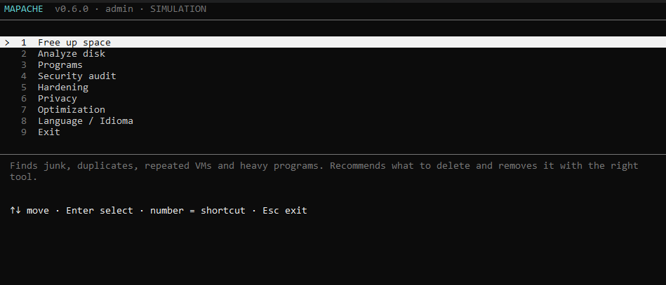
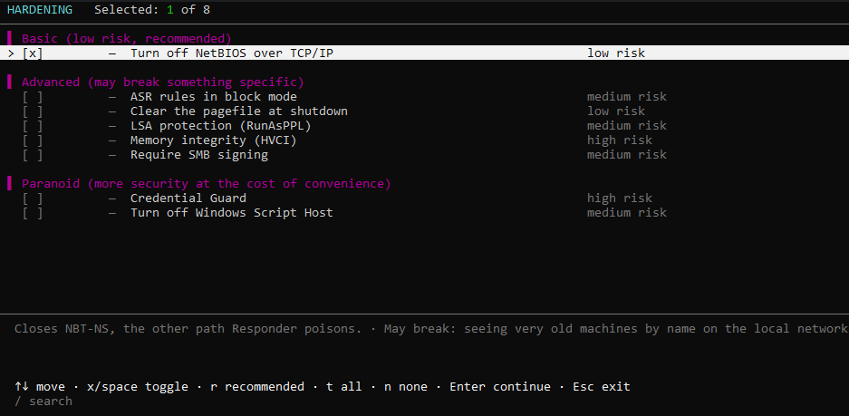
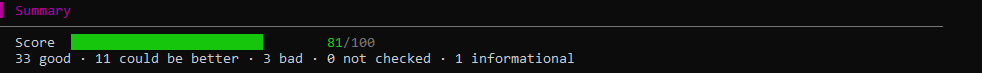
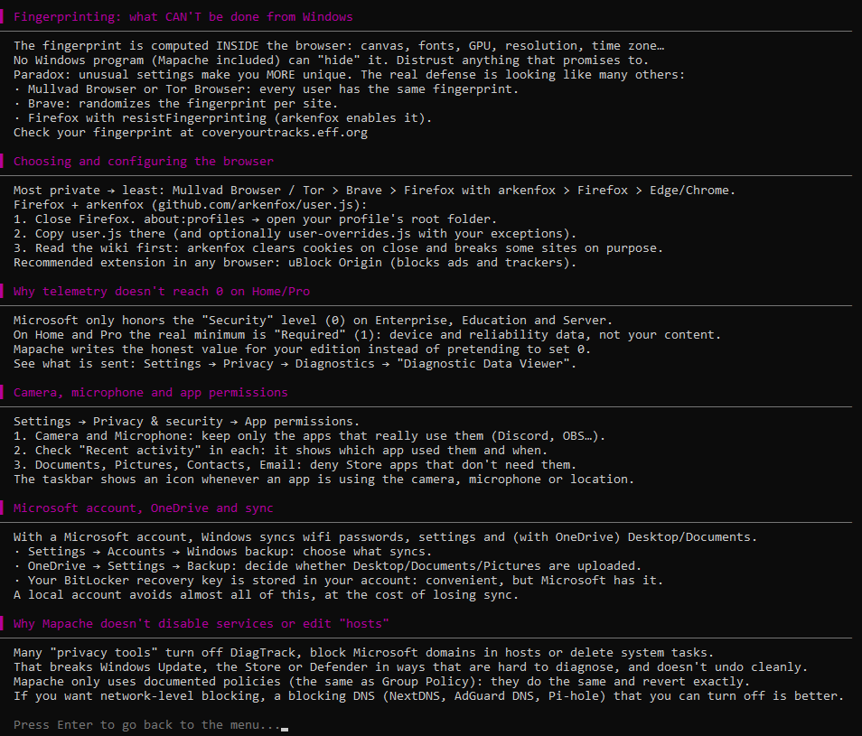

<p align="center">
  
</p>
<h1 align="center">Mapache</h1>
<p align="center">Clean up, audit and harden your Windows PC</p>
<p align="center">
  <a href="https://github.com/nytrek/mapache/actions/workflows/tests.yml"></a>
  <a href="LICENSE"></a>
</p>
<p align="center"><a href="README.es.md">Español</a></p>

Mapache is a terminal tool for Windows that frees disk space, uninstalls programs with their leftovers,
audits the security of the system and applies hardening, privacy and performance settings that can be
undone. It is written in pure Python with no third-party dependencies.

## Features

- **Free up space** — finds caches, temporary files, duplicate files, repeated VirtualBox VMs and large
  downloads, and removes them with the right tool (VBoxManage, official uninstallers, DISM).
- **Disk report** — what takes up space: folder tree, games, file types and largest files.
- **Programs** — Win32 and Store apps with measured size and last use (UserAssist and Prefetch),
  official uninstallers run silently when possible, then a leftover scan (folders, registry keys,
  services, tasks, Run entries, shortcuts, firewall rules) with a `.reg` backup before deletion.
- **Security audit** — 48 read-only checks (BitLocker, Secure Boot, Defender, ASR, firewall, SMB,
  LLMNR/NetBIOS, credential protection, memory artifacts, persistence and infostealer indicators)
  with a score and a report.
- **Hardening** — security settings in three levels (basic, advanced, paranoid), each one with its risk
  and what it may break.
- **Privacy** — Windows telemetry, advertising ID, activity history, Start menu ads, Recall, and
  browser policies for Chrome, Edge, Brave and Firefox.
- **Optimization** — startup programs (same mechanism as Task Manager), third-party scheduled tasks
  and power plan. No registry cleaners, RAM boosters or blanket service tweaks.

Hardening, Privacy and Optimization share one engine: before applying anything Mapache creates a
restore point and saves the previous value of every setting, and **Undo** restores them exactly.

## Screenshots

<p align="center"></p>

Hardening settings grouped by level, each with its risk and what it may break:

<p align="center"></p>

Security audit score:

<p align="center"></p>

Privacy guides, including what a Windows tool cannot do about browser fingerprinting:

<p align="center"></p>

## Safety

- `--simulate` shows what would happen without changing anything.
- Nothing is deleted without an explicit selection and a typed confirmation.
- Registry keys and scheduled tasks are exported before they are removed.
- Microsoft Defender is never disabled.
- Variable data is never interpolated into PowerShell commands; it is passed through environment
  variables.

No configuration tool protects against a targeted attack by a well-funded adversary. Mapache aims at
the common cases: a lost or stolen device, commodity malware, attacks on shared networks and sensitive
data left on disk.

## Usage

Requires Windows 10 or 11 and Python 3 (tested on 3.14). Some features need administrator rights;
Mapache offers to relaunch elevated.

```powershell
python -m mapache                 # main menu
python -m mapache clean           # free up space
python -m mapache disk            # disk report
python -m mapache programs        # uninstaller
python -m mapache audit           # security audit
python -m mapache harden          # hardening
python -m mapache privacy         # privacy
python -m mapache optimize        # optimization
python -m mapache --simulate      # dry run
python -m mapache --lang es       # Spanish interface
```

Or double-click `Mapache.bat`. Settings, logs, backups and reports are stored in `%APPDATA%\Mapache\`.

## Roadmap

- [x] Cleaner, disk report, uninstaller, audit, hardening, privacy and optimization
- [ ] Faster scanner in Rust (direct NTFS MFT reading)
- [ ] Graphical interface

## Security

To report a vulnerability, see [SECURITY.md](SECURITY.md).

## Contributing

See [CONTRIBUTING.md](CONTRIBUTING.md) for the architecture and how to add a detector, a check, a
setting or a language.

## License

[MIT](LICENSE)

## Acknowledgments

Built with the help of Claude Code.
